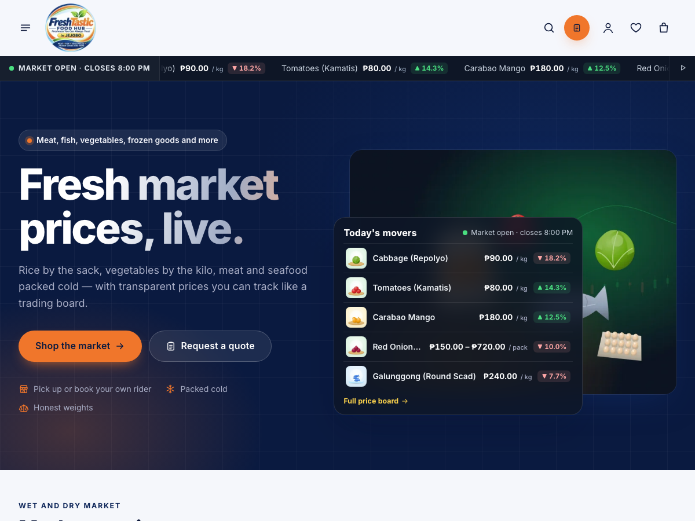

# Freshtastic Food Hub — Market Edition

A WooCommerce theme for **wet and dry market** stores — rice, vegetables, fruits, meat, poultry, eggs, fish and dry goods — with a **trading-floor design**: live price ticker, price board with ▲▼ changes from real price history, price-per-kg comparisons, and **Request for Quotation** for items that aren't posted, are out of stock, or are needed in bulk. Includes a companion plugin, a 36-product demo market with original artwork, and Philippine defaults (₱, PH shipping and payments). Translation-ready.

## What's in this package

| Path | What it is |
|---|---|
| `dist/nexora-commerce.zip` | **Installable theme.** Storefront, WooCommerce templates, Customizer settings, `theme.json`. |
| `dist/nexora-commerce-toolkit.zip` | **Companion plugin.** Demo importer/cleanup, wishlist, newsletter providers, analytics events, testimonials. |
| `nexora-commerce/` | Theme source. |
| `nexora-commerce-toolkit/` | Plugin source, including `demo/data/*.json` (catalog) and `demo/images/` (88 images). |
| `tools/image-generator/` | Script that regenerates the demo artwork from vector source. |
| `docs/` | Setup, configuration, marketing, customization and testing guides. |

## Quick start

1. **Install the theme:** Appearance → Themes → Add New → Upload → `nexora-commerce.zip` → Activate.
2. **Install the plugin:** Plugins → Add New → Upload → `nexora-commerce-toolkit.zip` → Activate. On a site without WooCommerce the **built-in store** starts, so WooCommerce is not needed. A site already running WooCommerce keeps it.
3. **Set up the store:** Store → Settings (address, pickup points, payment details).
4. **Import the demo (no WooCommerce needed):** Tools → Freshtastic Demo Content → tick the confirmation → *Import demo content* (about one minute).
5. **Customize:** Appearance → Customize → *Freshtastic Theme* and *Freshtastic Homepage*.

Full instructions: [docs/SETUP.md](docs/SETUP.md).

## Documentation

- [Setup and installation](docs/SETUP.md)
- [**Market features and quotation requests**](docs/MARKET-AND-QUOTATIONS.md)
- [**Maintenance mode and temporary access**](docs/MAINTENANCE-MODE.md)
- [**Checkout, pickup / courier delivery and the Order Desk**](docs/CHECKOUT-AND-ORDER-DESK.md)
- [**Branding and customer accounts**](docs/BRANDING-AND-CUSTOMER-ACCOUNT.md)
- [**Built-in store (no WooCommerce)**](docs/BUILT-IN-STORE.md)
- [**Facebook and Instagram: catalog sync and auto-posting**](docs/META.md)
- [**Online payments with PayMongo (GCash, Maya, cards, QR Ph)**](docs/PAYMONGO.md)
- [WooCommerce configuration checklist](docs/WOOCOMMERCE-CHECKLIST.md)
- [Philippine store configuration (₱, shipping, GCash/Maya/cards)](docs/PHILIPPINES-STORE-SETUP.md)
- [Marketing integrations (SEO, email, analytics, feeds)](docs/MARKETING.md)
- [Theme customization, hooks and template overrides](docs/CUSTOMIZATION.md)
- [Demo images: licensing and replacement workflow](docs/IMAGES.md)
- [Testing checklist, results and known limitations](docs/TESTING.md)

## Requirements

WordPress 6.5+ (tested on 7.1.3), WooCommerce 8.5+ (tested on 11.2.1), PHP 7.4+ (tested on 8.4).

## Licenses

- Theme and plugin code: GPL-2.0-or-later.
- Inter and Manrope fonts: SIL Open Font License 1.1 (license files in `nexora-commerce/assets/fonts/`).
- Demo artwork: original vector illustrations created for this project, released under CC0. No third-party photos are bundled.
- All products, prices, sales figures, reviews and testimonials in the demo are fictional sample content and are labelled as such on the site.
